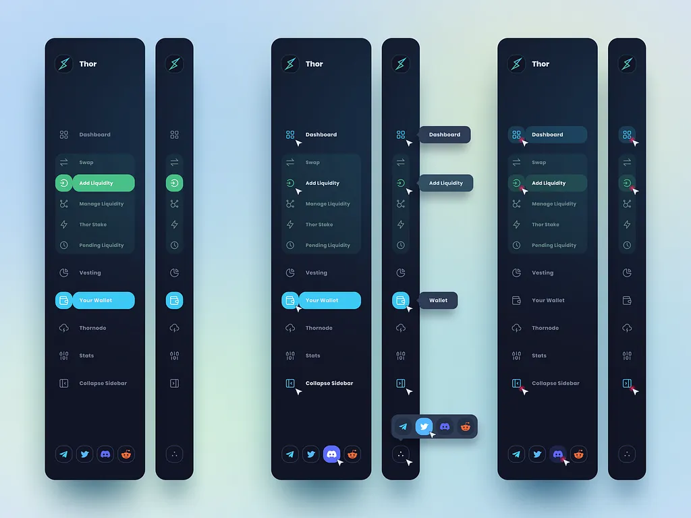
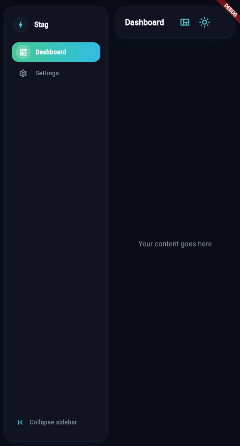
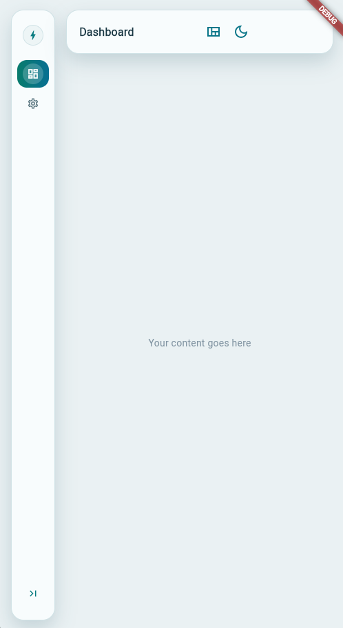
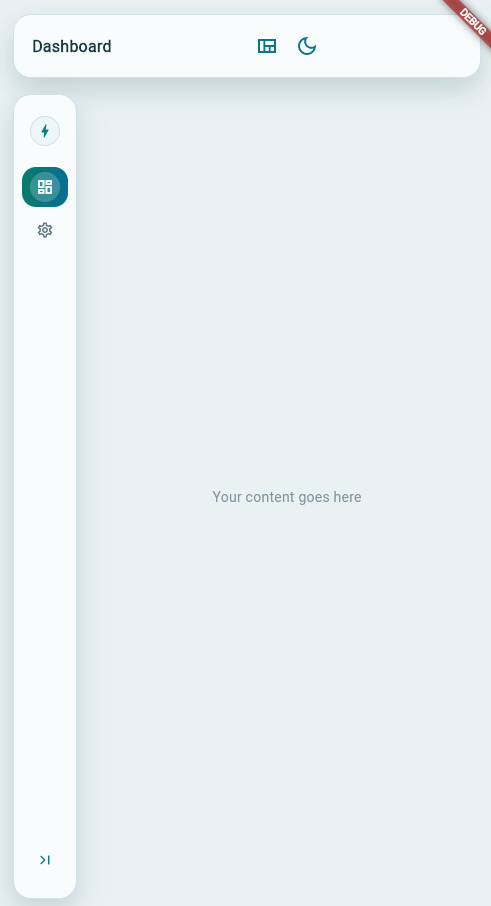

# stag_sidebar

A Flutter sidebar inspired by the reference design, with a dark theme, navigation groups, highlighted selection, and expanded and compact modes.

## Visual reference

The image below shows the design that inspired the sidebar, including its expanded and compact modes. To see the current implementation and try its interactions, run the [example](#local-preview).



### Example screenshots

The integration example combines the sidebar and app bar in different layouts and themes:

| Dark theme, expanded sidebar | Light theme, compact sidebar | Light theme, app bar above sidebar |
| --- | --- | --- |
|  |  |  |

## Installation

Add this to your project's `pubspec.yaml`:

```yaml
dependencies:
  stag_sidebar: ^0.2.3
```

For a matching app bar, consider the companion `stag_appbar` package. It is
optional, and both components can be used independently. While `stag_appbar`
is not yet published, add it from a local checkout:

```yaml
dependencies:
  stag_sidebar: ^0.2.3
  stag_appbar:
    path: ../stag_appbar # Adjust to your checkout's location.
```

## Using stag_sidebar with stag_appbar

`StagAppBarLayout` arranges both components and your page in a bounded area:

```dart
import 'package:flutter/material.dart';
import 'package:stag_appbar/stag_appbar.dart';
import 'package:stag_sidebar/stag_sidebar.dart';

Scaffold(
  body: SafeArea(
    child: Padding(
      padding: const EdgeInsets.all(16),
      child: StagAppBarLayout(
        mode: StagAppBarLayoutMode.aboveSidebar,
        appBar: const StagAppBar(title: Text('Dashboard')),
        sidebar: StagSidebar(
          selectedId: selectedId,
          onItemSelected: onItemSelected,
          sections: const [
            StagSidebarSection(items: [
              StagSidebarItem(
                id: 'dashboard',
                label: 'Dashboard',
                icon: Icons.dashboard_outlined,
              ),
            ]),
          ],
        ),
        body: const Center(child: Text('Page content')),
      ),
    ),
  ),
)
```

`aboveSidebar` (the default) places the app bar above both the sidebar and
page. Use `StagAppBarLayoutMode.besideSidebar` to place the sidebar on the
left and the app bar above the page. Set `spacing` to adjust the gaps. Use
`StagAppBarStyle.light()` and `StagSidebarStyle.light()` together for matching
light colors; their default constructors provide the dark palette. The layout
does not automatically collapse the sidebar, so provide enough space or start
it collapsed on narrow screens.

For a runnable example with a layout switch, theme switch, and navigation,
see [example/integration](example/integration). It uses local checkouts of both
packages.

## Usage

```dart
import 'package:flutter/material.dart';
import 'package:stag_sidebar/stag_sidebar.dart';

StagSidebar(
  selectedId: selectedId,
  onItemSelected: (id) => setState(() => selectedId = id),
  logo: const Icon(Icons.bolt, color: Color(0xFF52C9D7)),
  title: 'My brand',
  sections: [
    StagSidebarSection(items: [
      StagSidebarItem(id: 'dashboard', label: 'Dashboard', icon: Icons.dashboard),
      StagSidebarItem(id: 'wallet', label: 'Wallet', icon: Icons.account_balance_wallet),
    ]),
  ],
  actions: [
    StagSidebarAction(
      label: 'Community',
      icon: Icons.people,
      onPressed: () => debugPrint('Community'),
    ),
  ],
)
```

Customize colors, typography, spacing, dimensions, corners, the selected gradient, and animation with `StagSidebarStyle`. Each group can have its own background color and spacing; each item can override its selected gradient or color. `initiallyCollapsed` sets the initial state, and `onCollapsedChanged` reports when the user switches compact mode. In compact mode, shortcuts appear in a horizontal bar when hovering over or tapping the actions button. On narrow screens or when there are many shortcuts, the bar scrolls horizontally.

## Light theme

Use `StagSidebarStyle.light()` to apply the light palette. As with the default style, all properties can be customized:

```dart
StagSidebar(
  style: const StagSidebarStyle.light(
    accentColor: Colors.teal,
    borderRadius: 16,
  ),
  sections: const [], // Add your navigation items.
)
```

To switch themes, update `style` to `const StagSidebarStyle.light()` or `const StagSidebarStyle()` in your application's state. The included example demonstrates this.

The transition respects the system's reduced-motion preference. The sidebar uses the available height and scrolls when its content does not fit; provide enough width for `expandedWidth` and `collapsedWidth` in the containing layout. On mobile, use `initiallyCollapsed: true` to start in compact mode if desired.

## Submenus

An item with `children` opens or closes its submenu when activated, in both expanded and compact modes:

```dart
StagSidebarItem(
  id: 'swap',
  label: 'Swap',
  icon: Icons.swap_horiz,
  children: [
    StagSidebarItem(id: 'add', label: 'Add Liquidity', icon: Icons.add_circle_outline),
    StagSidebarItem(id: 'manage', label: 'Manage Liquidity', icon: Icons.tune),
  ],
)
```

Use unique IDs throughout the sidebar. Items with children toggle their submenu and execute their `onTap` callback, if provided; `onItemSelected` is called for items without children. `initiallyExpanded` opens a group initially. Set the group's color with `submenuBackgroundColor` on the item or in `StagSidebarStyle`; spacing and duration use the style's `submenuPadding` and `animationDuration`.

## Local preview

The `example` project demonstrates the component with items, groups, and actions inspired by the reference. To open it in Chrome:

```bash
cd example
flutter run -d chrome
```
